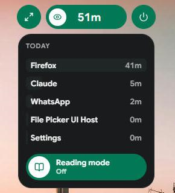
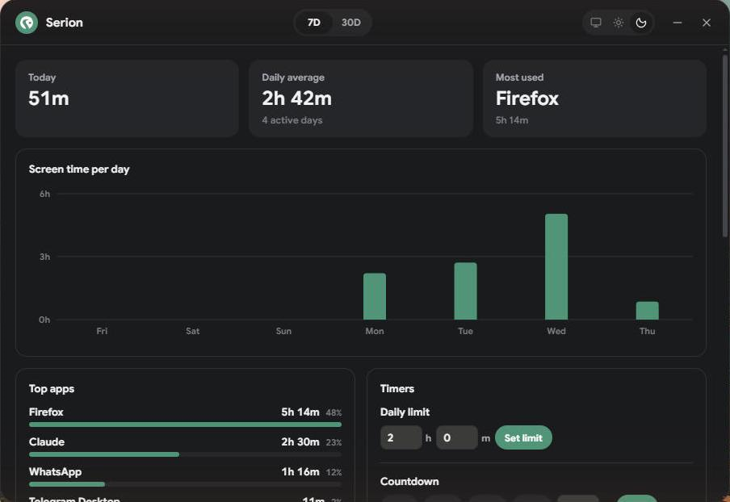

# Serion

A small pill at the top of your screen that shows how long you have
**actually** used your computer today, not just how long it has been switched on.

<p align="center">
  
  
</p>

Serion runs on Windows 10 and 11 (64-bit).

## What it does

- **Honest screen time.** Time counts only while you use the computer. Five
  minutes without input means you are away, and those five minutes are taken
  back off. A video or call that keeps the screen awake still counts.
- **Per-app time.** Click the pill to see today's top apps.
- **Dashboard.** Seven- and thirty-day history, daily average and most-used
  apps. Open it with the expand button that appears when you hover the pill.
- **Timers.** A daily limit and a countdown, with a red flash and a chime
  when they run out.
- **Breaks.** Optional reminders to drink water, stretch or rest your eyes.
  They are offered, never forced: start or skip them from the pill.
- **Reading mode.** Reading a long page? Switch it on from the pill and
  Serion waits 20 minutes instead of 5 before it calls you idle.
- **Stays out of the way.** It hides while a video or game is fullscreen,
  and you can hide it from screen recordings and screenshots.
- **Make it yours.** Six themes, light or dark dashboard, small or large pill,
  sounds on or off, and you can drag the pill anywhere on the screen.

## Install

1. Download `Serion_x.x.x_x64-setup.exe` from the
   [Releases page](https://github.com/mahtamun-hoque-fahim/serion/releases).
   No release there yet? Build it yourself (see below).
2. Run it. The installer is not signed yet, so Windows may show
   "Windows protected your PC". Click **More info**, then **Run anyway**.
3. Serion starts and the pill appears at the top center of your screen.
   Turn on **Start at login** in its settings if you want it every day.

To uninstall, use **Settings > Apps** in Windows. The uninstaller asks
whether to delete your history too; by default it is kept.

## Using the pill

| Do this | To get |
|---|---|
| Hover the pill | the **expand** button (dashboard) and the **settings** button |
| Click the pill | today's top apps and the reading mode switch |
| Drag the pill | move it anywhere; it snaps to the top center and to screen edges |
| Right-click the pill | quit Serion |

The icon in the pill tells you what is happening: an eye while it counts, a
moon when you are idle, a hand when nothing is open to count, an hourglass
while a countdown runs.

## Your data stays yours

- Everything is stored on your computer only, in `%APPDATA%\com.serion.app`.
  Serion never sends anything over the internet.
- The files are encrypted, so opening them shows nothing readable.
- You choose how long history is kept, and you can move the data folder,
  export a backup or import one from the dashboard.

## Build from source

You need [Node.js](https://nodejs.org/) 22 or newer,
[Rust](https://www.rust-lang.org/tools/install) (stable, MSVC) and the
Visual Studio Build Tools with the "Desktop development with C++" workload.

Serion encrypts its data with a key that is not in this repository. Create
your own 32-byte key once, in PowerShell from the project folder:

```powershell
$key = New-Object byte[] 32; [Security.Cryptography.RandomNumberGenerator]::Create().GetBytes($key); [IO.File]::WriteAllBytes("$PWD\src-tauri\serion.key", $key)
```

Keep a copy of `src-tauri/serion.key` somewhere safe: a build with a
different key cannot read data saved with this one.

Then:

```bash
npm install
npm run tauri dev
```

`npm run tauri build` makes the installer and prints where it put it
(by default under `C:/rust-target/serion`, set in `src-tauri/.cargo/config.toml`).

## License

[MIT](LICENSE) © 2026 Mahtamun Hoque Fahim
