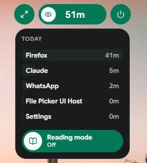
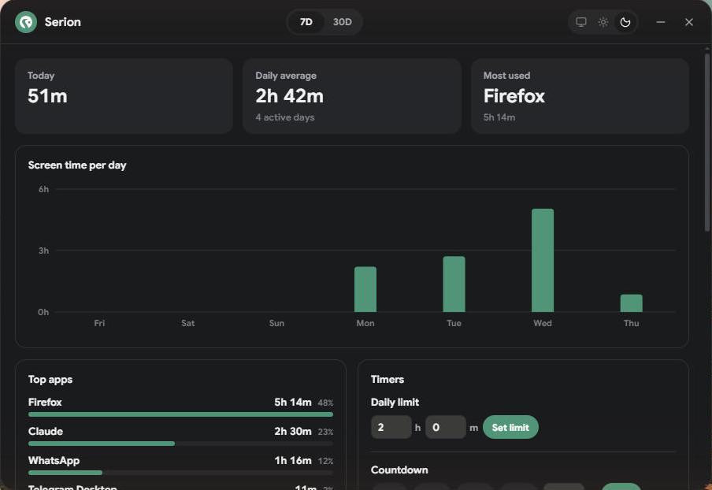
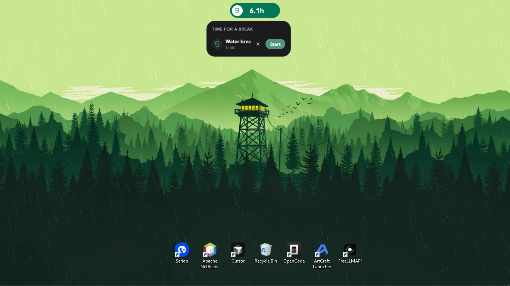

# Serion


**You were at your computer all day. But how much of that did you actually use?**

Windows counts from the moment you log in until you shut down: lunch, a phone
call, the meeting down the hall, all of it. Serion counts only the time you are
really there, and shows it in a small pill at the top of your screen.

<p align="center">
  
  
</p>

Free and open source, for Windows 10 and 11 (64-bit).
[Download the latest release](https://github.com/mahtamun-hoque-fahim/serion/releases).

## What Serion helps with

### "I have no idea where my day went"

- **Honest screen time.** Time counts only while you use the computer. After
  five minutes without input Serion calls you away, and takes those five
  minutes back off. A video or call that keeps the screen awake still counts.
- **Per-app time.** Click the pill to see today's top apps.
- **A dashboard for the bigger picture.** Seven- and thirty-day history, your
  daily average and your most-used apps. Open it with the expand button that
  appears when you hover the pill.

### "I lose hours without noticing"

- **Timers.** Set a daily limit or a countdown. When it runs out the pill
  flashes red and a chime plays.

### "I forget to drink water, stand up, or rest my eyes"

- **Breaks.** Turn on reminders for water, a stretch or resting your eyes, and
  choose how often. When one is due, the pill offers it: start it, or dismiss
  it and carry on. Nothing is forced, and screen time pauses while a break
  runs.

<p align="center">
  
</p>

### "I read long pages and get marked as idle"

- **Reading mode.** Switch it on from the pill and Serion waits 20 minutes
  instead of 5 before it calls you away.

### "I don't want another thing on my screen"

- **As visible as you like.** Keep the pill hidden (the default: Serion counts
  quietly from the tray by the clock), show just its icon, or the full pill
  with today's time.
- **Stays out of the way.** It hides while a video or game is fullscreen, and
  you can hide it from screen recordings and screenshots.
- **Make it yours.** Six themes, a light or dark dashboard, a small or large
  pill, sounds on or off, and you can drag the pill anywhere on the screen.

### "I don't want my activity sent anywhere"

- Everything stays on your computer, in `%APPDATA%\com.serion.app`. Serion
  never sends anything over the internet. No account, no cloud.
- The files are encrypted, so opening them shows nothing readable.
- You choose how long history is kept, and you can move the data folder,
  export a backup or import one from the dashboard.

## Get started in 30 seconds

1. Download `Serion_x.x.x_x64-setup.exe` from the
   [Releases page](https://github.com/mahtamun-hoque-fahim/serion/releases).
2. Run it. The installer is not signed yet, so Windows may show
   "Windows protected your PC". Click **More info**, then **Run anyway**.
3. Serion starts quietly: its icon sits in the tray by the clock (Windows may
   tuck it under the **^** arrow; drag it out to keep it visible). Click it
   to open the dashboard. To see the pill on screen, choose **Icon** or
   **Full** under **Pill**. Turn on **Start at login** there too if you want
   Serion every day.

To uninstall, use **Settings > Apps** in Windows. The uninstaller asks
whether to delete your history too; by default it is kept.

## Using the pill

The tray icon is always there: click it for the dashboard, right-click it to
quit. With the pill showing (Icon or Full):

| Do this | To get |
|---|---|
| Hover the pill | the **expand** button (dashboard) and the **settings** button |
| Click the pill | today's top apps and the reading mode switch |
| Drag the pill | move it anywhere; it snaps to the top center and to screen edges |
| Right-click the pill | quit Serion |

The icon in the pill tells you what is happening: an eye while it counts, a
moon when you are idle, a hand when nothing is open to count, an hourglass
while a countdown runs.

## Build from source

You need [Node.js](https://nodejs.org/) 22 or newer,
[Rust](https://www.rust-lang.org/tools/install) (stable, MSVC) and the
Visual Studio Build Tools with the "Desktop development with C++" workload.

Serion encrypts its data with a key that is not in this repository. Create
your own 32-byte key once, in PowerShell from the project folder:

```powershell
$key = New-Object byte[] 32; [Security.Cryptography.RandomNumberGenerator]::Create().GetBytes($key); [IO.File]::WriteAllBytes("$PWD\src-tauri\serion.key", $key)
```

Keep a copy of `src-tauri/serion.key` somewhere safe: a build with a
different key cannot read data saved with this one.

Then:

```bash
npm install
npm run tauri dev
```

`npm run tauri build` makes the installer and prints where it put it
(by default under `C:/rust-target/serion`, set in `src-tauri/.cargo/config.toml`).

## License

[MIT](LICENSE) © 2026 Mahtamun Hoque Fahim

The commits that built this app were written together with AI assistants; every
co-author is listed in [CREDITS.md](CREDITS.md).
